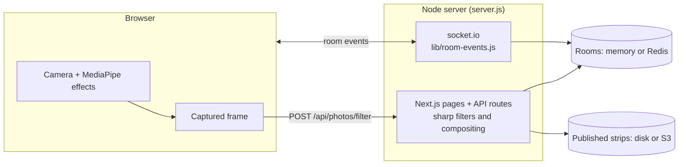

# Online Photobooth

A photobooth you share with friends from your phones. One person creates a room and shows the QR code; everyone who scans it joins the same room, takes turns on a synced countdown, and the photos land in one shared strip that anyone can download, share or publish as a link.

Built with Next.js 14 (App Router) and socket.io on a single Node server. Photos are colour-graded and composited on the server with `sharp`; background blur/replacement and face props run in the browser with MediaPipe.

## Features

**In the room**
- Join by QR code or room code, with an optional 4–6 digit PIN
- Synced 3-2-1 countdown on every screen; only one person can shoot at a time, and everyone sees who
- Keep or retake before a photo is shared with the room; retake any slot later
- Strip layouts: 2×2, 1×4, 1×2 and 2×3, with a caption and date printed underneath
- Photo history: every kept photo stays available and can be put into any slot
- Boomerang clips (recorded in the browser, shared with the room)
- Reconnects on its own after a dropped connection and restores the room's state

**Camera**
- Colour filters (B&W, sepia, vintage, cool, warm, high contrast), previewed live and applied on the server
- Background blur, studio backdrops or your own background photo (MediaPipe selfie segmentation)
- Face props: sunglasses, bunny ears, top hat (MediaPipe face landmarks)
- Mirror and front/back camera switch, shutter sound, flash and haptics

**Sharing**
- Download, the system share sheet, or a public link with its own QR code
- Interface in Indonesian, English and Chinese

## How it works



1. `POST /api/rooms` creates a room with a random 5-character code (no look-alike characters) and the chosen layout.
2. Each participant joins over socket.io. From then on every event acts on the room that socket joined; the room code a client sends is ignored, so knowing a code is not enough to write into a room or skip its PIN.
3. **Shoot** asks the server for the camera lock. If nobody holds it, the server broadcasts the countdown to everyone and, at zero, tells only the shooter's device to take the picture. The lock is released on Keep, Retake or disconnect, with a 30-second safety timeout.
4. The frame goes to `/api/photos/filter` (sharp), comes back as a preview, and is broadcast to the room only after **Keep**.
5. **Combine into strip** calls `/api/photos/compose`, which lays the photos out with `sharp.composite` and prints the caption and date.

### Safety limits
- The routes that accept data (create room, filter, compose, publish) check the size before parsing, decode images with sharp (anything that isn't a real JPEG, PNG or WebP is rejected) and are rate-limited per IP.
- Socket events validate slot numbers and payload types and sizes. Five wrong PINs disconnect the socket.
- Published strips are re-encoded as plain JPEGs, so nothing but an image is ever served from a public link.

## Run it

```bash
npm install
npm run dev          # http://localhost:3000
```

`npm run dev` and `npm run build` first run `scripts/fetch-mediapipe.mjs`, which copies the MediaPipe runtime from `node_modules` and downloads the two models into `public/mediapipe/`. The app then serves them itself instead of loading them from jsDelivr and Google Cloud Storage, which are slow or blocked on some networks. If a model can't be downloaded, the browser falls back to Google's copy.

**Phones on the same Wi-Fi:** browsers only allow the camera on `https://` or `localhost`, so a phone opening `http://192.168.x.x:3000` won't get camera access. Use an HTTPS tunnel instead:

```bash
npm run dev
ngrok http 3000                      # or: cloudflared tunnel --url http://localhost:3000
PUBLIC_URL=https://<your-tunnel> npm run dev   # so QR codes point at the tunnel
```

### Configuration
Everything is optional; with no configuration the app keeps rooms in memory and published strips on local disk. See [`.env.example`](.env.example).

| Variable | Effect |
|---|---|
| `REDIS_URL` | Rooms in Redis: survive restarts, work across several instances, expire by TTL |
| `S3_BUCKET`, `S3_ACCESS_KEY_ID`, `S3_SECRET_ACCESS_KEY`, `S3_ENDPOINT`, `S3_PUBLIC_URL_BASE` | Published strips in S3, Cloudflare R2 or another S3-compatible store |
| `STRIPS_DIR` | Folder for published strips without S3 (default `data/strips`) |
| `PUBLIC_URL` | Address used in QR codes and links (behind a proxy, or a tunnel in dev) |

### Checks
```bash
npm run lint
npm run typecheck
npm test             # 79 tests: socket events, image validation, layout maths, rate limiting, translations
npm run build
```
The socket tests run the real event handlers against a real socket.io server. They cover PIN rejection, events from sockets that never joined, slot and payload validation, and the camera lock. CI runs all of these plus a Docker build on every push.

## Deploy (Fly.io, Singapore region)

`fly.toml` targets `sin` (Singapore), the closest Fly region to Indonesia and mainland China now that Hong Kong is gone (Tokyo, `nrt`, is the alternative). It keeps one machine running so socket.io connections aren't dropped by cold starts.

```bash
fly launch --no-deploy   # keep the existing fly.toml; pick a unique app name
fly deploy
```

Published strips on local disk disappear on redeploy. To keep them, either configure S3/R2, or create a volume and uncomment the `[mounts]` block in `fly.toml`:

```bash
fly volumes create photobooth_data --region sin --size 1
```

The Docker image builds with `npm ci`, ships production dependencies only, runs as the unprivileged `node` user and has a health check on `/api/health`.

## Project layout

```
server.js                 Next.js + socket.io on one HTTP server
app/
  page.tsx                create a room (layout, optional PIN)
  room/[code]/page.tsx    the room: wires hooks and panels together
  api/rooms/              create a room, room info + join QR
  api/photos/             filter, compose, publish
  api/health/             status and usage counters
  strips/[file]/          serves strips published to local disk
components/room/          join card, QR panel, camera, capture controls, strip
hooks/                    useRoomSocket, useCamera, useLiveEffects
lib/
  room-events.js          socket.io handlers (join, countdown, lock, capture)
  rooms.js                room store (memory or Redis), room codes
  http.ts                 rate limiting, JSON and image validation for routes
  storage.js              published strips: local disk or S3
  cv/                     MediaPipe segmentation, face landmarks, effects, boomerang
  i18n.tsx                Indonesian / English / Chinese strings
scripts/fetch-mediapipe.mjs   self-hosted MediaPipe runtime and models
tests/                    Vitest
```

## Limits
- With the in-memory store, rooms live in one server process: a restart clears them, and you can't run more than one instance without Redis.
- Rate limits are per instance (in memory).
- There are no accounts: anyone with the code (and PIN, if set) can join a room.
